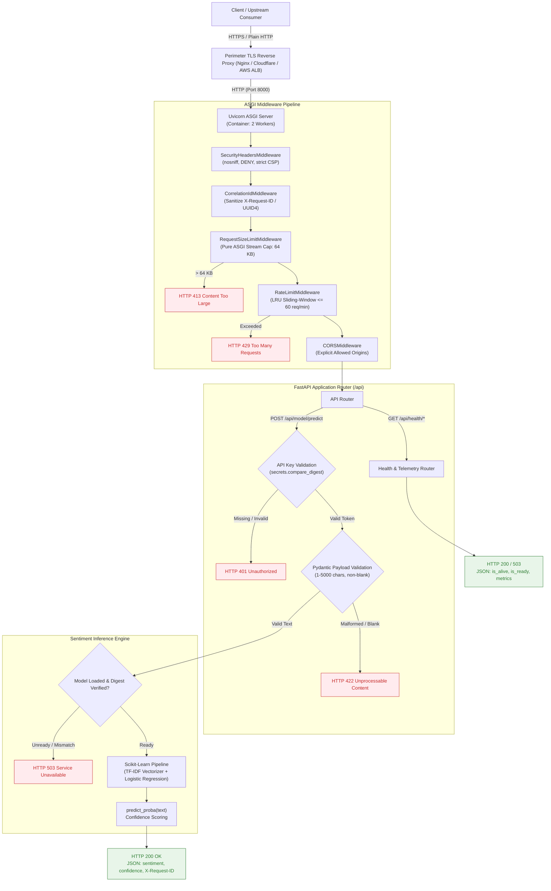

<div align="center">

# PyServe AI API

### Production-Grade Sentiment Analysis Microservice with Hardened ASGI Execution & Cryptographic Model Integrity

[](https://www.python.org/)
[](https://fastapi.tiangolo.com/)
[](https://scikit-learn.org/)
[](https://www.docker.com/)
[](#12-testing-and-verification)
[](#12-testing-and-verification)
[](LICENSE)

<p align="center">
  <b>PyServe AI API</b> bridges the gap between machine learning research and enterprise production serving.<br>
  Built on modern <b>FastAPI</b>, it provides an authenticated, low-latency REST interface for binary sentiment classification, fortified with <b>pre-deserialization SHA-256 artifact verification</b>, <b>pure ASGI streaming payload limits</b>, <b>bounded in-memory rate limiting</b>, and a <b>read-only container runtime</b>.
</p>

[Quick Start](#7-getting-started) • [Architecture](#4-system-architecture) • [Security Controls](#11-security-engineering) • [Docker Deployment](#8-docker-deployment) • [API Reference](#9-api-reference)

</div>

---

## Table of Contents

- [1. At a Glance](#1-at-a-glance)
- [2. Why This Project Exists](#2-why-this-project-exists)
- [3. Key Architectural Pillars](#3-key-architectural-pillars)
- [4. System Architecture](#4-system-architecture)
- [5. Technology Stack](#5-technology-stack)
- [6. Configuration Reference](#6-configuration-reference)
- [7. Getting Started](#7-getting-started)
- [8. Docker Deployment](#8-docker-deployment)
- [9. API Reference](#9-api-reference)
- [10. Model Provenance and Limitations](#10-model-provenance-and-limitations)
- [11. Security Engineering](#11-security-engineering)
- [12. Testing and Verification](#12-testing-and-verification)
- [13. Project Structure](#13-project-structure)
- [14. Roadmap and Contribution](#14-roadmap-and-contribution)
- [15. License and Attribution](#15-license-and-attribution)

---

## 1. At a Glance

| Attribute | Specification |
|:---|:---|
| **Primary Task** | Binary Sentiment Classification (`positive` vs. `negative`) |
| **Inference Engine** | Scikit-learn Pipeline: `TfidfVectorizer` (unigrams + bigrams) + L2-regularized `LogisticRegression` |
| **Input Format** | JSON payload: `{"text": "<string 1-5000 characters>"}` |
| **Output Format** | JSON response: `{"sentiment": "positive", "confidence": 0.6493}` |
| **Authentication** | Header-based secret token (`token: <API_KEY>`) validated using constant-time comparison |
| **Security Envelope** | Pre-deserialization SHA-256 check, 64 KB streaming payload cap, sliding-window rate limit, non-root Docker execution |
| **Observability** | Standardized health probes (`/api/health/heartbeat`, `/api/health/ready`), operational metrics, structured logs, and UUID4 correlation IDs |
| **Target Audience** | Machine Learning Engineers, API Platform Engineers, and DevSecOps teams seeking a blueprint for secure Python model deployment |

> [!NOTE]
> **Discriminative Classifier, Not a Generative LLM:** PyServe AI API serves a classical statistical machine learning classifier trained on discrete review text. As a discriminative model, it does not generate freeform text or exhibit generative LLM hallucinations. However, like all statistical classifiers, it can produce misclassifications or inaccurate predictions when evaluated on ambiguous, out-of-domain, or adversarial inputs.

---

## 2. Why This Project Exists

Deploying machine learning models in production requires far more than wrapping a `model.predict()` call in a basic web framework. Data science prototypes frequently exhibit severe production vulnerabilities when exposed to live traffic:

```
┌──────────────────────────────────────┐     ┌──────────────────────────────────────┐
│       Fragile Prototype Trap         │     │     PyServe AI API Production State   │
├──────────────────────────────────────┤     ├──────────────────────────────────────┤
│ ❌ Untrusted joblib/pickle loading   │ ──► │ ✅ Pre-deserialization SHA-256 check │
│ ❌ Unbounded request payloads (DoS)  │ ──► │ ✅ Pure ASGI 64 KB stream guardrail  │
│ ❌ Unthrottled traffic abuse         │ ──► │ ✅ LRU-bounded sliding rate limiter  │
│ ❌ Containers running as root (0)    │ ──► │ ✅ Non-root user (10001) + read-only │
│ ❌ Interactive Swagger exposed prod  │ ──► │ ✅ Docs disabled in production tier  │
│ ❌ Secrets and text leaked in logs   │ ──► │ ✅ Sanitized structured logging      │
└──────────────────────────────────────┘     └──────────────────────────────────────┘
```

PyServe AI API addresses these challenges directly. It demonstrates how to serve a serialized ML artifact with **defense-in-depth security**, **predictable error boundaries**, and **fully reproducible dependency locking**.

---

## 3. Key Architectural Pillars

### 🛡️ Pre-Deserialization Cryptographic Integrity
Python's `pickle` and `joblib` formats allow arbitrary bytecode execution during unpickling. If an attacker tampers with an artifact on disk or inside a container image, loading it grants remote code execution (RCE).  
**The Solution:** `SentimentModelService` computes the artifact's SHA-256 hash before opening the file. In production, if the hash does not match `EXPECTED_MODEL_SHA256`, the service fails closed with `ModelLoadError` without calling `joblib.load()`.

> [!NOTE]
> **Integrity Scope:** Pre-deserialization SHA-256 verification confirms that an artifact has not been modified after training and matches the configured digest. It defends against post-training tampering, corrupted downloads, and untrusted artifact substitution, but does not protect against a compromised training pipeline or an attacker who can alter `EXPECTED_MODEL_SHA256` in configuration.

### ⚡ Pure ASGI Streaming Payload Guardrails
Standard framework request size middleware often inspects only the `Content-Length` header. Malicious clients can bypass this by omitting the header or using `Transfer-Encoding: chunked`, buffering gigabytes into memory.  
**The Solution:** `RequestSizeLimitMiddleware` intercepts raw ASGI receive events. It immediately rejects requests exceeding 64 KB (`HTTP 413 Content Too Large`) while streams are in-flight, preventing memory exhaustion attacks.

### ⏱️ Bounded In-Memory Sliding-Window Rate Limiting
Unthrottled public endpoints invite volumetric denial-of-service and credential brute-forcing.  
**The Solution:** `RateLimitMiddleware` maintains sliding-window timestamps per client IP. To prevent memory exhaustion attacks from millions of spoofed IPs, entries are capped at 10,000 keys using a thread-safe `OrderedDict` with Least-Recently-Used (LRU) eviction.

### 🔒 Zero-Trust Container Hardening
Default Docker setups run as `root` with writable root filesystems.  
**The Solution:** The production container image runs under dedicated user `pyserve` (UID 10001), enforces an immutable `555` application filesystem, mounts an ephemeral tmpfs at `/tmp`, and operates under full `--read-only` container confinement.

---

## 4. System Architecture

The following diagram illustrates the complete request lifecycle through the ASGI middleware stack, authentication gate, Pydantic validation schemas, and the sentiment inference service:



---

## 5. Technology Stack

```
Runtime Framework     FastAPI 0.143.3 • Starlette 1.8.0 • Uvicorn 0.54.0 • Pydantic 2.14.1
Machine Learning      Scikit-learn 1.9.1 • NumPy 2.5.4 • SciPy 1.18.1 • Joblib 1.6.0
Quality & Validation  Pytest 9.1.1 • Black 26.10.1 • Flake8 7.4.1 • Mypy 2.4.0
Security & Auditing   pip-audit 2.10.1 • secrets.compare_digest • Cryptographic SHA-256
Packaging & Locking   PEP 621 Standard • uv 0.9.17 • uv.lock (74 packages) • pip 26.2
Containerization      Docker (Multi-stage python:3.13-slim) • Non-Root UID 10001 • Read-Only Root
```

---

## 6. Configuration Reference

Configuration is managed via environment variables (or an optional local `.env` file for local development), validated during application startup by `validate_config()`:

| Variable | Type | Default | Description | Required in Production? |
|:---|:---:|:---:|:---|:---:|
| `ENVIRONMENT` | string | `production` | Execution tier: `production`, `development`, or `test`. | Yes |
| `API_KEY` | string | `None` | Shared secret key expected in the `token` HTTP header. Must be at least 32 characters in production. | **Yes** |
| `EXPECTED_MODEL_SHA256` | string | `a37aa3bf39b8...` | 64-character hexadecimal SHA-256 digest of the model artifact. | **Yes** |
| `DEFAULT_MODEL_PATH` | string | `models/sentiment.pkl` | Relative or absolute path to the serialized `.pkl` artifact. | No |
| `ALLOWED_ORIGINS` | string | `http://localhost:3000,http://127.0.0.1:3000` | Comma-separated list of allowed CORS browser origins. | No |
| `TRUSTED_PROXIES` | string | `""` | Comma-separated list of trusted upstream reverse proxy IPs for client IP extraction. | No |
| `RATE_LIMIT_PER_MINUTE` | int | `60` | Maximum allowed requests per minute per client IP address. | No |
| `MAX_RATE_LIMIT_ENTRIES`| int | `10000` | Maximum distinct client IP entries retained in the in-memory LRU cache. | No |
| `MAX_REQUEST_BYTES` | int | `65536` (64 KB) | Maximum allowed HTTP request body size in bytes. | No |
| `LOG_LEVEL` | string | `INFO` | Logging threshold: `DEBUG`, `INFO`, `WARNING`, `ERROR`. | No |
| `IS_DEBUG` | bool | `False` | Enables debug mode (strictly rejected if `ENVIRONMENT=production`). | No |

---

## 7. Getting Started

Follow these steps to set up and run the service locally.

### Prerequisites
- Python 3.11, 3.12, or 3.13 installed
- Git installed

### 1. Clone the Repository
```bash
git clone https://github.com/Himanshusekharsahoo/PyServe-AI-API.git
cd PyServe-AI-API
```

### 2. Set Up a Virtual Environment

**Windows (PowerShell):**
```powershell
python -m venv .venv
.\.venv\Scripts\Activate.ps1
```

**macOS / Linux (Bash):**
```bash
python3 -m venv .venv
source .venv/bin/activate
```

### 3. Install Locked Dependencies

Install the verified production runtime dependencies using `pip` or `uv`:
```bash
# Using standard pip
pip install -r requirements.txt

# Or using uv for high-speed installation
uv pip install -r requirements.txt
```

*(Optional: To run unit tests, linters, and audits, install development tools: `pip install black flake8 mypy pytest pip-audit`)*.

### 4. Configure Local Environment
Copy the example environment file:
```bash
cp .env.example .env
```

Generate a secure test API key (minimum 32 characters) and configure it in `.env` or set it in your session:

**Windows (PowerShell):**
```powershell
$env:ENVIRONMENT="development"
$env:API_KEY="local-dev-secret-token-exceeding-32-chars-long"
```

**macOS / Linux (Bash):**
```bash
export ENVIRONMENT="development"
export API_KEY="local-dev-secret-token-exceeding-32-chars-long"
```

### 5. Launch the Service
```bash
uvicorn app.main:app --host 127.0.0.1 --port 8000 --reload
```

### 6. Verify Service Readiness
Open a separate terminal window and verify the health endpoints:
```bash
# Liveness probe
curl http://127.0.0.1:8000/api/health/heartbeat

# Readiness probe
curl http://127.0.0.1:8000/api/health/ready
```

In `development` tier, interactive documentation is accessible at:
- Swagger UI: [http://127.0.0.1:8000/docs](http://127.0.0.1:8000/docs)
- ReDoc: [http://127.0.0.1:8000/redoc](http://127.0.0.1:8000/redoc)

---

## 8. Docker Deployment

The repository includes a hardened multi-stage [`Dockerfile`](Dockerfile) designed for minimal attack surface and compliance with strict container security standards.

### 1. Build Container Image
```bash
docker build -t pyserve-ai-api:latest .
```

### 2. Run Container with Hardened Restrictions

Run the container using non-root execution, a read-only root filesystem, and an ephemeral in-memory `/tmp` mount:

**Local Development Container Run:**
```bash
docker run -d \
  --name pyserve-api \
  --read-only \
  --tmpfs /tmp:rw,noexec,nosuid,size=64m \
  -p 127.0.0.1:8000:8000 \
  -e ENVIRONMENT=development \
  -e API_KEY=local-dev-test-token-exceeding-32-characters-length \
  pyserve-ai-api:latest
```

*(Alternatively, load local environment settings from a file: `docker run -d ... --env-file .env pyserve-ai-api:latest`)*.

### 3. Container Hardening Highlights
- **Unprivileged Execution:** Runs as user `pyserve` (`UID 10001`, `GID 10001`) with `/sbin/nologin` shell.
- **Read-Only Root Filesystem:** Configured via `--read-only`. Application files in `/app` are owned by `root:root` with immutable `chmod 555` permissions.
- **Writable Temporary Storage:** `/tmp` is mounted via `--tmpfs` with `1777` permissions to allow Python runtime scratch needs without granting disk write access to source code.
- **Native Healthcheck:** Uses Python standard library `urllib.request` to poll `/api/health/heartbeat` every 30 seconds.

> [!IMPORTANT]
> **Production Deployment Requirements:**
> 1. **Secret Management:** Avoid passing production API keys in plain `-e API_KEY=...` command-line flags, where values can be recorded in shell history and container inspection metadata. Instead, inject secrets using container orchestration secret managers (e.g., Kubernetes Secrets, AWS Secrets Manager, HashiCorp Vault) or restricted environment files.
> 2. **TLS Termination:** The container exposes plain HTTP on port 8000. Production deployments must place an external TLS reverse proxy (Nginx, Caddy, Traefik, AWS ALB, Cloudflare) in front to handle HTTPS termination and edge certificate lifecycle.

---

## 9. API Reference

### Endpoints Overview

| Method | Endpoint | Auth Required | Description |
|:---:|:---|:---:|:---|
| `GET` | `/api/health/heartbeat` | No | Liveness probe; confirms service process is alive. |
| `GET` | `/api/health/ready` | No | Readiness probe; returns HTTP 200 when model is loaded, 503 when unready. |
| `GET` | `/api/health/metrics` | No | Operational telemetry (uptime, requests, error counts, worker PID). |
| `POST`| `/api/model/predict` | **Yes** (`token` header) | Classifies sentiment for provided text string. |

---

### Detailed Endpoint Specifications

#### 1. Liveness Probe: `GET /api/health/heartbeat`
Returns the operational liveness status of the API instance.

**Example Request:**
```bash
curl -i http://127.0.0.1:8000/api/health/heartbeat
```

**Example Response (`HTTP 200 OK`):**
```json
{
  "is_alive": true
}
```

---

#### 2. Readiness Probe: `GET /api/health/ready`
Confirms whether the sentiment model has been verified and loaded into memory to serve inference requests.

**Example Request:**
```bash
curl -i http://127.0.0.1:8000/api/health/ready
```

**Example Response (`HTTP 200 OK`):**
```json
{
  "is_ready": true
}
```

---

#### 3. Operational Metrics: `GET /api/health/metrics`
Reports process-local operational counters for the worker servicing the request.

**Example Request:**
```bash
curl -i http://127.0.0.1:8000/api/health/metrics
```

**Example Response (`HTTP 200 OK`):**
```json
{
  "worker_pid": 8,
  "uptime_seconds": 128.45,
  "total_requests": 142,
  "total_predictions": 89,
  "total_errors": 2,
  "model_loaded": true
}
```

---

#### 4. Sentiment Prediction: `POST /api/model/predict`
Runs sentiment classification on the provided text string.

**Headers:**
- `token`: `<API_KEY>` (Required)
- `Content-Type`: `application/json`

**Example 1: Positive Sentiment Prediction**
```bash
curl -i -X POST http://127.0.0.1:8000/api/model/predict \
  -H "token: local-dev-secret-token-exceeding-32-chars-long" \
  -H "Content-Type: application/json" \
  -d '{"text": "The platform is incredibly fast, dependable, and intuitive."}'
```

**Response (`HTTP 200 OK`):**
```json
{
  "sentiment": "positive",
  "confidence": 0.6493
}
```

**Example 2: Negative Sentiment Prediction**
```bash
curl -i -X POST http://127.0.0.1:8000/api/model/predict \
  -H "token: local-dev-secret-token-exceeding-32-chars-long" \
  -H "Content-Type: application/json" \
  -d '{"text": "Terrible experience, completely broken and useless."}'
```

**Response (`HTTP 200 OK`):**
```json
{
  "sentiment": "negative",
  "confidence": 0.6859
}
```

---

### Error Responses & Status Codes

| Status Code | Reason | Example Response Body |
|:---:|:---|:---|
| **`401 Unauthorized`** | Missing or incorrect `token` header | `{"detail": "Authentication required."}` |
| **`413 Content Too Large`** | Request payload exceeds 64 KB (65,536 bytes) | `{"detail": "Payload size exceeds maximum allowed limit of 65536 bytes."}` |
| **`422 Unprocessable`** | Empty, whitespace-only, or >5,000 char text | `{"detail": [{"loc": ["body", "text"], "msg": "Input text cannot be empty or blank whitespace."}]}` |
| **`429 Too Many Requests`** | Client IP exceeded per-minute request limit | `{"detail": "Rate limit exceeded. Please retry after some time."}` *(includes `Retry-After: 60`)* |
| **`503 Unavailable`** | Model uninitialized or integrity check failed | `{"detail": "Inference unavailable: Model integrity verification failed..."}` |

---

## 10. Model Provenance and Limitations

### Pipeline & Training Methodology
The model artifact ([`models/sentiment.pkl`](models/sentiment.pkl)) is trained via [`scripts/train_model.py`](scripts/train_model.py) using Scikit-learn:
- **Feature Extraction:** `TfidfVectorizer(ngram_range=(1, 2), min_df=2, sublinear_tf=True)`
- **Classification Engine:** `LogisticRegression(max_iter=1000, random_state=42)`
- **Dataset:** UCI Sentiment Labelled Sentences (Dataset 331, DOI [10.24432/C57604](https://doi.org/10.24432/C57604)), licensed CC BY 4.0 (Kotzias, D., 2015). Comprises 3,000 sentences evenly split across IMDb, Amazon, and Yelp reviews.
- **Evaluation Split:** Deterministic stratified 80/20 train/test split (2,400 training rows, 600 held-out test rows).

### Confidence Score Semantics
Confidence scores represent the model-estimated class probability output by Scikit-learn's `predict_proba()` for the predicted label, bounded between `0.0` and `1.0`. Note that these values reflect standard Logistic Regression logistic sigmoid outputs; post-hoc empirical probability calibration (such as Platt scaling or isotonic regression) has not been evaluated.

### Real-World Limitations
1. **Domain Scope:** The model was trained specifically on short English product and entertainment reviews. It is **not designed for general-domain NLP**, technical documentation, or legal analysis.
2. **Linguistic Complexity:** As a classical linear TF-IDF classifier, the model lacks deep semantic transformer attention. It may misclassify subtle sarcasm, complex double negatives, multilingual text, slang, or emoji-heavy strings.
3. **Confidence vs. Ground Truth:** High confidence reflects statistical feature alignment within the training distribution, not an infallible guarantee of factual sentiment accuracy.

---

## 11. Security Engineering

PyServe AI API implements defense-in-depth security across three distinct structural boundaries:

```
┌────────────────────────────────────────────────────────────────────────┐
│ 1. Perimeter / Reverse Proxy Layer (Nginx, Traefik, AWS ALB, Caddy)    │
│    • TLS Certificate Termination & HTTPS Encryption                   │
│    • Ingress Header Normalization & IP Spoofing Prevention             │
└───────────────────────────────────┬────────────────────────────────────┘
                                    ▼
┌────────────────────────────────────────────────────────────────────────┐
│ 2. Container Confinement Layer (Docker Runtime)                        │
│    • Non-Root Execution: User pyserve (UID 10001, GID 10001)           │
│    • Read-Only Root Filesystem: --read-only flag                       │
│    • Immutable Application Code: chmod -R 555 /app                     │
│    • Ephemeral Scratch Space: --tmpfs /tmp                             │
└───────────────────────────────────┬────────────────────────────────────┘
                                    ▼
┌────────────────────────────────────────────────────────────────────────┐
│ 3. Application Security Layer (FastAPI ASGI Service)                   │
│    • Pre-Deserialization Integrity: SHA-256 verification before joblib │
│    • Request Size Enforcer: Pure ASGI stream guardrail (64 KB cap)    │
│    • Bounded Rate Limiting: Sliding-window LRU cache (10,000 keys)     │
│    • Constant-Time Auth: secrets.compare_digest against API_KEY        │
│    • Correlation Sanitization: X-Request-ID validated to UUID4 regex   │
│    • Security Headers: nosniff, DENY, no-referrer, strict CSP          │
│    • Reconnaissance Defense: /docs, /redoc, /openapi.json disabled     │
│    • Zero Secret Leakage: PII and keys excluded from structured logs   │
└────────────────────────────────────────────────────────────────────────┘
```

### Architectural Concurrency Considerations
- **Process-Local Metrics & Rate Limiting:** In multi-worker configurations (such as Uvicorn with `--workers 2`), each worker process maintains an isolated in-memory rate limiter and metrics dictionary. Request rates are enforced per-worker rather than globally synchronized.
- **Enterprise Recommendation:** For horizontally autoscaled deployments across Kubernetes pods, rate limiting should be enforced at an upstream API Gateway (e.g., Kong, Envoy) or backed by Redis. Metrics should be scraped across pods via Prometheus.

---

## 12. Testing and Verification

Every quality gate and security control in PyServe AI API is backed by repeatable automated verification.

### Verification Summary Baseline
The following results represent actual local verification results recorded during release hardening:

| Verification Stage | Command | Target / Scope | Result |
|:---|:---|:---|:---:|
| **Unit & Integration Suite** | `pytest -v` | 48 test cases across app, auth, config, limits, and ML | **48/48 PASSED** |
| **Live Host E2E Checks** | `python scripts/verify_e2e.py` | 44 real HTTP integration requests against live Uvicorn | **44/44 PASSED** |
| **Docker Container E2E** | Live HTTP container suite | 10 real HTTP requests against container with `--read-only` | **10/10 PASSED** |
| **Code Formatting** | `black --check app tests scripts` | 31 source files inspected (88-character limit) | **CLEAN** |
| **Style & Linting** | `flake8 app tests scripts` | PEP 8, complexity, and docstring checks | **CLEAN** |
| **Static Type Checking** | `mypy app tests scripts` | Strict type validation across 31 source files | **CLEAN** |
| **Dependency Lock Check** | `uv lock --check` | Validates `uv.lock` matches `pyproject.toml` | **SYNCHRONIZED** |
| **Vulnerability Audit** | `pip-audit -r requirements.txt` | Scans 25 production dependencies against PyPI/OSV database | **0 Known Vulnerabilities (at scan time)** |

> [!NOTE]
> All test suites and quality gates above were executed and verified in the local development and container runtime environments. Remote GitHub Actions CI execution is pending repository publication and initial push.

### Running the Checks Locally
```bash
# 1. Automated Unit & Integration Tests
pytest -v

# 2. Code Quality & Formatting
black --check app tests scripts
flake8 app tests scripts
mypy app tests scripts

# 3. Live End-to-End Integration Verification
python scripts/verify_e2e.py

# 4. Dependency Vulnerability Audit
pip-audit -r requirements.txt
```

---

## 13. Project Structure

```
PyServe-AI-API/
├── .github/
│   └── workflows/
│       └── ci.yml               # Least-privilege CI workflow (Black, Flake8, Mypy, pip-audit, Pytest)
├── app/
│   ├── api/
│   │   └── routes/
│   │       ├── heartbeat.py     # Liveness (/heartbeat), readiness (/ready), and metrics (/metrics)
│   │       ├── prediction.py    # Authenticated sentiment classification (/predict)
│   │       └── router.py        # Central route aggregator
│   ├── core/
│   │   ├── config.py            # Centralized settings & fail-closed production validation
│   │   ├── event_handlers.py    # Startup & shutdown application lifecycle hooks
│   │   ├── logging.py           # Structured, sanitized operational logging
│   │   ├── messages.py          # Standardized error messages
│   │   ├── metrics.py           # In-memory operational metrics collector
│   │   ├── middleware.py        # Correlation ID, security headers, request size, & rate limiting
│   │   └── security.py          # Timing-safe header-based API key validation
│   ├── models/                  # Pydantic schemas
│   │   ├── heartbeat.py         # HeartbeatResult, ReadinessResult, MetricsResult schemas
│   │   ├── payload.py           # TextPayload request schema (length & whitespace validation)
│   │   └── prediction.py        # PredictionResponse schema
│   ├── services/
│   │   ├── model_service.py     # SentimentModelService with SHA-256 pre-check & inference
│   │   └── models.py            # Historical reference schemas
│   └── main.py                  # FastAPI application factory (create_app)
├── models/
│   └── sentiment.pkl            # Trained Scikit-learn TF-IDF + Logistic Regression pipeline
├── scripts/
│   ├── train_model.py           # Reproducible UCI dataset training & SHA-256 digest generator
│   └── verify_e2e.py            # Live HTTP end-to-end integration verification suite
├── tests/                       # 48 automated unit, integration, and security test cases
├── .dockerignore                # Container build exclusion rules
├── .env.example                 # Documented environment template with safe defaults
├── .flake8                      # Flake8 style configuration
├── .gitignore                   # Comprehensive Git exclusion rules
├── Dockerfile                   # Multi-stage, non-root, read-only production container definition
├── MODEL_SPEC.md                # Detailed ML model specification and dataset attribution
├── pyproject.toml               # Canonical PEP 621 packaging metadata & tool configurations
├── requirements.txt             # 25 locked, reproducible production runtime dependencies
└── uv.lock                      # Cryptographically hashed multi-platform universal lockfile
```

---

## 14. Roadmap and Contribution

### Planned Enhancements
- [ ] **ONNX Runtime Export:** Provide an optional ONNX runtime export for higher inference throughput and cross-language deployment without Python pickle dependencies.
- [ ] **Prometheus Exporter:** Add a native `/metrics` format compatible with standard Prometheus scrapers.
- [ ] **Distributed Rate Limiting:** Provide an optional Redis-backed sliding-window rate limiter for multi-node deployments.

### Contributing
Contributions that enhance security, performance, or documentation are welcome:
1. Fork the repository and create a feature branch (`git checkout -b feat/my-enhancement`).
2. Implement your changes, ensuring code comments and docstrings are maintained.
3. Verify that all quality gates pass:
   ```bash
   black app tests scripts
   flake8 app tests scripts
   mypy app tests scripts
   pytest -v
   ```
4. Submit a detailed Pull Request.

---

## 15. License and Attribution

- **Software License:** PyServe AI API is licensed under the [MIT License](LICENSE). Full terms are available in the repository root [`LICENSE`](LICENSE) file.
- **Upstream Attribution:** Incorporates architectural patterns from [`eightBEC/fastapi-ml-skeleton`](https://github.com/eightBEC/fastapi-ml-skeleton), originally released under the Apache License 2.0. The upstream project's Apache-2.0 terms apply to its original skeleton code, while PyServe AI API itself is published under the MIT License.
- **Dataset Attribution:** Trained on the *Sentiment Labelled Sentences* dataset (Kotzias, D., 2015), UCI Machine Learning Repository (DOI [10.24432/C57604](https://doi.org/10.24432/C57604)), licensed under [Creative Commons Attribution 4.0 International (CC BY 4.0)](https://creativecommons.org/licenses/by/4.0/).

---

<div align="center">
  <sub>Engineered with precision for production reliability. Maintainer: <a href="https://github.com/Himanshusekharsahoo">Himanshu Sekhar Sahoo</a></sub>
</div>
